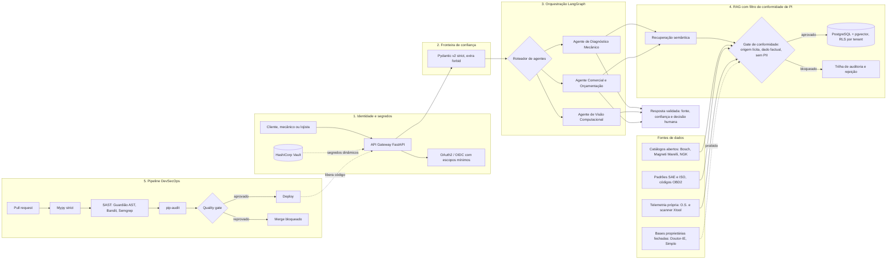

# Ricardo Luiz G. Flávio — Direito Digital × Segurança da Informação × Engenharia de IA

[](https://www.linkedin.com/in/ricardo-flavio/)


> **Bacharelado em Direito** — FACIC, Cruzeiro (7º semestre) · **Graduação em Segurança da Informação** — UCB, Universidade
> Católica de Brasília (3º semestre) · **Em busca de estágio** em AppSec, DevSecOps, GRC, Direito Digital e Engenharia de IA.

**Lorena, São Paulo, Brasil** · **30+ anos de experiência prática** em Eletrônica Embarcada (ECU/EPROM/CAN), Telemetria Satelital e Infraestrutura de Hardware/Redes.

**Em transição estratégica para Segurança da Informação** (AppSec, DevSecOps e Cibersegurança Automotiva/IoT), **Governança de IA e Direito Digital (LGPD)**. A especialização prática está em eletrônica, telemetria e infraestrutura; cibersegurança é a área de transição formal e estudo.

Na Mecânica Rally, liderança da transformação digital e implantação da vertical de seguros e rastreamento, associada a **+60% de crescimento da operação**, conforme relato profissional do titular. Credenciado Ituran desde 2018. Formação: Direito (7º semestre — FACIC), Segurança da Informação (3º semestre — UCB) e Mecatrônica (UNI VITÓRIA TEC).

**Headline oficial PT-BR — 207 caracteres:**

```text
Segurança da Informação, DevSecOps & Direito Digital | Governança de IA, LGPD & RAG (Python/LangGraph) | 30+ anos em Eletrônica Embarcada (ECU/CAN), Telemetria & Redes | Direito (7º sem.) & SecInfo (3º sem.)
```

**Headline oficial EN-US — 202 caracteres:**

```text
Information Security, DevSecOps & Digital Law | AI Governance, Privacy (LGPD) & RAG (Python/LangGraph) | 30+ yrs in Embedded Systems (ECU/CAN), Telemetry & Networks | Law (7th sem.) & InfoSec (3rd sem.)
```

O [kit de posicionamento](docs/LINKEDIN_KIT.md) contém as headlines oficiais e o Sobre nos dois idiomas, com distinção entre trajetória prática, transição de carreira e escopo técnico demonstrável.

**Escopo comprovável:** este checkout demonstra Python/Pydantic, auditor AST, recuperação lexical em memória, StateGraph próprio e workflow de auditoria. LangGraph, PostgreSQL/pgvector, OAuth2 e Vault integram a arquitetura de referência do produto; sua implementação no produto completo não é comprovada pelo código público. O schema rejeita registros com PII detectada e exige anonimização na origem; não anonimiza automaticamente nem certifica conformidade jurídica integral.

Busco estágio e posições de transição/projetos em AppSec, DevSecOps, GRC, Cibersegurança Automotiva/IoT, Direito Digital, Governança de IA e Engenharia de IA.

## 🇬🇧 Executive summary

Based in **Lorena, São Paulo, Brazil**, I bring **30+ years of hands-on experience in embedded electronics (ECU/EPROM/CAN), satellite telemetry and hardware/network infrastructure**. I am making a strategic transition into **Information Security (AppSec, DevSecOps and Automotive/IoT Cybersecurity), AI Governance and Digital Law (LGPD)**.

I study Law (7th semester, FACIC) and Information Security (3rd semester, UCB), alongside technical training in Mechatronics at UNI VITÓRIA TEC. My practical specialization is in electronics and telemetry; cybersecurity is my formal transition and study area.

The public showcase demonstrates Python/Pydantic validation, an AST auditor, a custom StateGraph, lexical retrieval in memory and a configured security workflow. LangGraph, PostgreSQL/pgvector, OAuth2 and Vault belong to the product reference architecture; this checkout does not establish their deployment in the complete product. Ingestion rules reject detected personal data and require source anonymization, rather than automatically anonymizing records or certifying legal compliance.

Seeking internships and transition/project opportunities in AppSec, DevSecOps, GRC, Automotive/IoT Cybersecurity, Digital Law, AI Governance and AI Engineering.

---

## 🎯 A convergência que diferencia este perfil

Segurança e Direito falam sobre o mesmo problema — **risco** — em linguagens diferentes. Eu traduzo entre as duas.

| Pergunta do jurídico | Pergunta da engenharia | Controle que eu entrego |
|---|---|---|
| "Podemos usar esse conteúdo para alimentar a IA?" | "Qual é a origem e a licença deste dado?" | `SourceType` + `SourceProvenance`: **Compliance as Code** que bloqueia fontes não auditadas na ingestão |
| "Há dado pessoal na telemetria?" (LGPD) | "O que entra no índice vetorial?" | *Privacy by Design*: base legal obrigatória, varredura de PII e segregação por `tenant_id` |
| "Como provamos diligência numa auditoria?" | "Onde está a evidência?" | `audit_id`, hash SHA-256 por fragmento e relatórios de CI como artefato |
| "A IA pode causar dano?" | "O que acontece se o LLM for manipulado?" | OWASP Top 10 for LLM: saída validada, ferramentas em *allow-list*, nenhum `eval` de saída de modelo |

Isso importa em times de AppSec, GRC, Privacidade e IA porque a pergunta relevante não é só "o modelo funciona?", e sim
**"conseguimos defender, técnica e juridicamente, como ele foi construído?"**

---

## 🏗️ Case principal: AutoTech AI OS & Zezé da Regulagem

Ecossistema **SaaS B2B/B2C** em **monorepo** para oficinas, mecânicos e motoristas.

**Módulos de negócio**

- **Planos de assinatura de manutenção preventiva** — recorrência, cobrança e histórico por veículo.
- **SOS Guincho / Emergência** — acionamento de socorro com geolocalização e despacho.
- **Barganha do Zezé** — *marketplace* P2P de peças e serviços com negociação.

**Arquitetura de referência dos agentes (LangGraph)**

| Agente | Responsabilidade | Fontes de conhecimento |
|---|---|---|
| Diagnóstico Mecânico / Engenharia | Hipóteses de falha a partir de sintomas e códigos DTC | RAG `pgvector` filtrado por conformidade |
| Visão Computacional | Leitura de peças, painéis e danos a partir de imagens | Imagens enviadas pelo usuário, com consentimento |
| Comercial / Orçamentação | Composição de orçamento e plano de manutenção | Catálogos abertos e histórico próprio de O.S. |

### Arquitetura de referência (fluxo seguro)



**Leitura do diagrama.** (1) toda requisição passa por OAuth2 e segredos nunca vivem no código; (2) nada entra nos agentes
sem validação estrita; (3) os agentes têm responsabilidades isoladas; (4) o RAG só admite dados que passaram pelo gate de
conformidade, e as fontes proibidas são bloqueadas por arquitetura; (5) o código que implementa tudo isso só chega à
produção após o *quality gate* de SAST.

### Engenharia de segurança (DevSecOps)

| Camada | Prática | Evidência neste repositório |
|---|---|---|
| Identidade | OAuth2 com escopos mínimos | ADR, risco R7 |
| Segredos | Gestão via **Vault**; zero credenciais no código | Regra GRD-002 do Guardião |
| Validação | **Pydantic v2** (`extra="forbid"`, limites e `Enum`) e **Mypy strict** | [`rag_legal_ingestion_schema.py`](showcase/rag_legal_ingestion_schema.py) |
| SAST proprietário | **Guardião**: análise de AST (`ast.NodeVisitor`), 8 regras com CWE/OWASP | [`devsecops_guardiao_ast.py`](showcase/devsecops_guardiao_ast.py) |
| SAST de mercado | **Bandit** e **Semgrep** (regras OWASP + regras próprias de governança de IA) | [`.semgrep/ai-governance.yml`](.semgrep/ai-governance.yml) |
| SCA | `pip-audit` sobre dependências fixadas | [`secops-audit.yml`](.github/workflows/secops-audit.yml) |
| Governança | ADR com matriz de risco e rastreabilidade normativa | [`COMPLIANCE_AND_AI_GOVERNANCE.md`](docs/COMPLIANCE_AND_AI_GOVERNANCE.md) |

### Governança jurídica e *IP compliance* (Legal Design técnico)

O RAG foi desenhado sob a **Lei 9.610/98** (Direitos Autorais), a **Lei 9.609/98** (Software) e a **LGPD**:

- ❌ **Proibido por arquitetura:** *scraping*, *crawling* ou extração de bases proprietárias fechadas (como Doutor-IE e
  Simplo).
- ✅ **Permitido:** dados técnicos **factuais** de domínio público (Ohms, Volts, bar, pinagem, códigos SAE/ISO OBD2, torques
  em Nm), **catálogos abertos** de fabricantes (Bosch, Magneti Marelli, NGK etc.) e **telemetria empírica própria**
  (Ordens de Serviço e scanner Xtool/OBD2).
- 🔐 **Privacy by Design:** telemetria exige base legal, anonimização e segregação por inquilino.

A lógica não é uma política em PDF: é o contrato de dados executável em
[`rag_legal_ingestion_schema.py`](showcase/rag_legal_ingestion_schema.py), testado em CI.

---

## 🧪 Showcase executável

| Arquivo | O que demonstra |
|---|---|
| [`showcase/devsecops_guardiao_ast.py`](showcase/devsecops_guardiao_ast.py) | Auditor SAST por AST: `eval`/`exec`, segredos *hardcoded*, SQL concatenado, *endpoints* sem validação, `shell=True`, desserialização insegura, TLS desabilitado e hashes fracos. Relatório no terminal, saída JSON e *quality gate* por severidade. |
| [`showcase/rag_legal_ingestion_schema.py`](showcase/rag_legal_ingestion_schema.py) | *Compliance as Code* com Pydantic v2: valida origem (`SourceType`), método de coleta, licença, PII e marcadores de copyright antes de qualquer escrita no `pgvector`. |
| [`showcase/langgraph_rag_agent.py`](showcase/langgraph_rag_agent.py) | Orquestrador multi-agente determinístico (`StateGraph`) sobre o gate jurídico: guardrail de **prompt injection (OWASP LLM01)**, RAG que só recupera fontes aprovadas, roteamento entre agentes de Diagnóstico, Visão e Comercial e guardrail de saída com citação rastreável (**OWASP LLM05**). Estado imutável e trilha de auditoria. |
| [`.github/workflows/secops-audit.yml`](.github/workflows/secops-audit.yml) | Pipeline: Mypy strict → Bandit → Semgrep → Guardião (autoteste + gate) → gate RAG → orquestrador multi-agente (autoteste + demo) → pip-audit. |
| [`.semgrep/ai-governance.yml`](.semgrep/ai-governance.yml) | Regras próprias de Semgrep, inclusive a que bloqueia referências a bases proprietárias fechadas. |
| [`docs/COMPLIANCE_AND_AI_GOVERNANCE.md`](docs/COMPLIANCE_AND_AI_GOVERNANCE.md) | RFC/ADR técnico-jurídico, matriz de risco e rastreabilidade normativa. |
| [`docs/LINKEDIN_KIT.md`](docs/LINKEDIN_KIT.md) | Kit de posicionamento: headlines, "Sobre", projeto (STAR), competências e posts. |

> **Escopo deste repositório.** Este é o *showcase público*: contém os componentes de segurança e conformidade que posso
> demonstrar sem expor o produto (auditor SAST, contrato de dados do RAG, orquestrador multi-agente com guardrails, pipeline
> de CI e ADR). O orquestrador usa um `StateGraph` próprio e determinístico, com a mesma API conceitual do LangGraph e com
> síntese opcional via API (`--live-llm`), mantendo o modo offline como padrão, para provar a arquitetura de controle. O monorepo completo do AutoTech AI OS (agentes com LLM, OAuth2/Vault,
> módulos de negócio), hoje em teste em uma oficina real em Lorena-SP, é privado.
> *Public showcase: the full product monorepo is private.*

### Executar localmente

```bash
python3 -m venv .venv && source .venv/bin/activate
python -m pip install -r requirements.txt -r requirements-dev.txt

python showcase/devsecops_guardiao_ast.py --demo        # relatório SAST de um módulo vulnerável
python showcase/devsecops_guardiao_ast.py --self-test   # regressão do detector
python showcase/devsecops_guardiao_ast.py showcase --fail-on high
python showcase/rag_legal_ingestion_schema.py           # gate de ingestão: 3 aceitos, 3 rejeitados
python showcase/langgraph_rag_agent.py                  # 3 cenários: legítimo, prompt injection, fonte não auditada
python showcase/langgraph_rag_agent.py --self-test      # 30+ verificações offline dos guardrails
python showcase/langgraph_rag_agent.py --live-llm       # opt-in; sem chave usa fallback offline
mypy --strict showcase && bandit -r showcase -ll
```

Trecho da saída do gate de ingestão:

```text
[ACEITO   ] Catálogo aberto Bosch — resistência de bobina
[REJEITADO] BLOQUEIO — scraping de base proprietária (Doutor-IE)
    motivo      : provenance: fonte proprietária fechada bloqueada (Lei 9.609/98 e Lei 9.610/98) ...
[REJEITADO] BLOQUEIO — telemetria com dado pessoal (placa e CPF)
    motivo      : <modelo>: dado pessoal detectado (CPF, placa): anonimize antes da ingestão (LGPD)
```

### Estrutura do repositório

```text
.
├── README.md
├── LICENSE
├── docs/
│   ├── COMPLIANCE_AND_AI_GOVERNANCE.md
│   └── LINKEDIN_KIT.md
├── assets/linkedin_post_card.html
├── scripts/
│   ├── linkedin_auto_config.py
│   └── linkedin_profile_data.json
├── showcase/
│   ├── devsecops_guardiao_ast.py
│   ├── langgraph_rag_agent.py
│   └── rag_legal_ingestion_schema.py
├── .semgrep/ai-governance.yml
├── .github/workflows/secops-audit.yml
├── pyproject.toml
├── requirements.txt
└── requirements-dev.txt
```

---

## 🧰 Competências

**Segurança:** AppSec · DevSecOps · SAST/AST · SCA · Threat Modeling · OWASP Top 10 · OWASP Top 10 for LLM · OAuth2 ·
Gestão de segredos (Vault) · Secure SDLC · GRC · ISO/IEC 27001.
**IA e dados:** Python · LangGraph · Multi-Agent Systems · RAG · PostgreSQL · pgvector · Pydantic · Mypy · FastAPI.
**Jurídico:** LGPD · Governança de IA · Propriedade Intelectual · Direitos Autorais (Lei 9.610/98) · Lei do Software
(Lei 9.609/98) · Privacy by Design · Compliance as Code · Legal Design.

## 🤝 Contato

**Ricardo Luiz G. Flávio** — Direito (FACIC Cruzeiro, 7º semestre) e Segurança da Informação (UCB, 3º semestre).

👉 [LinkedIn — Ricardo Luiz G. Flávio](https://www.linkedin.com/in/ricardo-flavio/)

Aberto a conversas sobre estágio e projetos em segurança, privacidade e IA responsável. O perfil no LinkedIn e este
repositório contam a mesma história: **segurança e conformidade projetadas desde o primeiro commit.**

> Aviso: o conteúdo jurídico deste repositório é educacional e de portfólio; não constitui aconselhamento jurídico.

Licença: [MIT](LICENSE).

## Trajetória, formação e certificados / Career, education and certificates

As oito experiências (1995–2026), as três formações e os sete certificados oficiais (**294 horas**) estão detalhados abaixo em PT-BR e EN-US.

### 2018 – Presente / Present | Mecânica Rally

**PT-BR — Gestor Sênior, Responsável Técnico & Arquiteto de Transformação Digital (AutoTech AI OS)** · Lorena, São Paulo, Brasil

Liderança técnica e governança; transformação digital e implantação da vertical de seguros e rastreadores (linha leve, pesada, motos e máquinas), impulsionando a empresa em +60%. Arquitetura do AutoTech AI OS & Zezé da Regulagem (Python, LangGraph, pgvector, DevSecOps, LGPD/IP Compliance).

**EN-US — Senior Manager, Technical Lead & Digital Transformation Architect (AutoTech AI OS)** · Lorena, São Paulo, Brazil

Technical leadership and governance; digital transformation and launch of insurance and tracking services for cars, heavy vehicles, motorcycles and machinery, driving over 60% growth. Architecture of AutoTech AI OS & Zezé da Regulagem (Python, LangGraph, pgvector, DevSecOps, LGPD/IP Compliance).

### 2018 – Presente / Present | Credenciado Ituran Rastreadores

**PT-BR — Técnico em Telemetria Satelital & Rastreamento Veicular (IoT)** · Lorena, São Paulo, Brasil

Instalação, manutenção e diagnóstico de telemetria satelital/RF em frotas pesadas, máquinas, veículos leves e motos, atendendo multinacionais, montadoras e seguradoras. Atuação em raio de 300 km de Lorena, SP. Base prática em eletrônica e telemetria aplicada à transição estratégica para estudos de Cibersegurança Automotiva/IoT; não apresentada como especialização profissional já estabelecida nessa área.

**EN-US — Satellite Telemetry & Vehicle Tracking Technician (IoT)** · Lorena, São Paulo, Brazil

Installation, maintenance and diagnostics of satellite/RF telemetry for heavy fleets, machinery, cars and motorcycles, serving multinationals, automakers and insurers within a 300 km radius of Lorena, SP. This practical electronics and telemetry background supports a strategic transition into Automotive/IoT Cybersecurity studies; it is not presented as established professional specialization in cybersecurity.

### 2003 – 2017 | Mecânica Rally 2

**PT-BR — Fundador, Gestor & Especialista em Eletrônica Embarcada (ECU / EPROM / ADAS)** · Lorena, São Paulo, Brasil

Reprogramação de módulos de injeção eletrônica (ECU) diretamente na memória EPROM (mapas de injeção, avanço de ignição, conversão de combustível na ECU), GNV (3ª, 5ª e 6ª geração com injeção direta), câmbio automático/automatizado, Air-Bag, ABS e sistemas ADAS, além da gestão integral do negócio e TI.

**EN-US — Founder, Manager & Embedded Electronics Specialist (ECU / EPROM / ADAS)** · Lorena, São Paulo, Brazil

ECU reprogramming directly in EPROM memory (injection maps, ignition timing and ECU fuel conversion); 3rd, 5th and 6th generation CNG with direct injection, automatic/automated transmissions, Air-Bag, ABS and ADAS. Full business and IT management.

### 2003 – 2003 | Onlinet Provedor de Internet

**PT-BR — Técnico de Infraestrutura de Redes, Servidores & Provimento de Acesso (UOL / Speedy Telefônica)** · Lorena, São Paulo, Brasil

Administração de servidores de internet, configuração de redes, implantação de acesso Speedy (Telefônica) e suporte técnico.

**EN-US — Network Infrastructure, Servers & Internet Access Technician (UOL / Speedy Telefônica)** · Lorena, São Paulo, Brazil

Internet server administration, network configuration, Speedy (Telefônica) access deployment and technical support.

### 2000 – 2002 | MBD Informática

**PT-BR — Executivo de Implantação de Laboratório de Hardware, Redes & Desenvolvimento** · Lorena, São Paulo, Brasil

Implantação da oficina de hardware (desktops, notebooks, impressoras), redes, programação, vendas técnicas e suporte. Site: loja.mbd.com.br.

**EN-US — Hardware Laboratory, Networks & Development Deployment Executive** · Lorena, São Paulo, Brazil

Deployed the hardware workshop (desktops, notebooks, printers), networks, programming, technical sales and support. Website: loja.mbd.com.br.

### 1998 – 2000 | Informat Escola de Computação

**PT-BR — Professor de Hardware, Infraestrutura & Pesquisador de Material Didático** · Lorena, São Paulo, Brasil

Docência em hardware e redes, pesquisa tecnológica e desenvolvimento de material didático.

**EN-US — Hardware & Infrastructure Instructor and Teaching Materials Researcher** · Lorena, São Paulo, Brazil

Hardware and networking instruction, technology research and development of teaching materials.

### 1997 – 2000 | Caas Computadores

**PT-BR — Técnico de Hardware, Redes & Suporte de TI** · Lorena, São Paulo, Brasil

Manutenção de computadores, notebooks e impressoras, cabeamento e configuração de redes e internet.

**EN-US — Hardware, Networks & IT Support Technician** · Lorena, São Paulo, Brazil

Computer, notebook and printer maintenance, cabling, network and internet configuration.

### 1995 – 1996 | Mecânica Rally

**PT-BR — Técnico em Mecatrônica & Diagnóstico de Injeção Eletrônica** · Lorena, São Paulo, Brasil

Atuação no início da injeção eletrônica no Brasil, diagnóstico de sensores, atuadores e mecatrônica automotiva.

**EN-US — Mechatronics & Electronic Fuel Injection Diagnostics Technician** · Lorena, São Paulo, Brazil

Worked during the early adoption of electronic fuel injection in Brazil, diagnosing sensors, actuators and automotive mechatronics.

### Formação acadêmica / Education

| Instituição / Institution | PT-BR | EN-US | Período / Period |
|---|---|---|---|
| FACIC — Faculdade de Ciências Humanas de Cruzeiro | Bacharelado em Direito, 7º semestre | Law (LL.B.), 7th semester | 2023–2028 |
| UCB — Universidade Católica de Brasília | CST em Segurança da Informação, 3º semestre | Technologist degree in Information Security, 3rd semester | 2025–2028 |
| UNI VITÓRIA TEC | Curso Técnico em Mecatrônica, concluinte | Technical Diploma in Mechatronics, completing in 2026 | 2026–2026 |

### Licenças e certificados / Licenses and certifications

**7 certificados oficiais / 7 official certificates — 294 horas / hours.** Títulos oficiais preservados em português; tradução em inglês para leitura.

### Programa Hackers do Bem — Formação em Cibersegurança: Curso Básico (64h)

EN-US: Hackers do Bem — Cybersecurity Training: Basic Course.

Emissor / Issuer: **SENAI São Paulo / RNP / Softex (MCTI)** · Emissão / Issued: **Março / March de 2026**.

### Programa Hackers do Bem — Formação em Cibersegurança: Nivelamento (80h)

EN-US: Hackers do Bem — Cybersecurity Training: Foundation.

Emissor / Issuer: **SENAI São Paulo / RNP / Softex (MCTI)** · Emissão / Issued: **Março / March de 2026**.

### Inteligência Artificial I — Conhecendo as Redes Neurais Artificiais (40h)

EN-US: Artificial Intelligence I — Introduction to Artificial Neural Networks.

Emissor / Issuer: **Instituto Federal do Triângulo Mineiro (IFTM)** · Emissão / Issued: **Agosto / August de 2026**.

Aproveitamento / Score: **92,50%**.

Credencial / Credential ID: `69a9cc0e-65e7-4f5e-81d8-09e6035856ef`.

### Direito Autoral, Crimes Cibernéticos e Tributos Aplicados a Eventos (20h)

EN-US: Copyright, Cybercrime and Taxes Applied to Events.

Emissor / Issuer: **Instituto Federal do Rio Grande do Sul (IFRS)** · Emissão / Issued: **Abril / April de 2026**.

Aproveitamento / Score: **84,17%**.

Credencial / Credential ID: `8a86dfe9-8e5a-49a8-814b-c7c1bf3743c3`.

### Curso Básico de Direito Espacial — 1ª Turma/2026 (20h)

EN-US: Basic Space Law Course — 1st Class/2026.

Emissor / Issuer: **Agência Espacial Brasileira (AEB / MCTI)** · Emissão / Issued: **Março / March de 2026**.

### Windows Server 2016: Instalação e Administração (40h)

EN-US: Windows Server 2016: Installation and Administration.

Emissor / Issuer: **Instituto Federal do Rio Grande do Sul (IFRS)** · Emissão / Issued: **Maio / May de 2026**.

Aproveitamento / Score: **89,38%**.

Credencial / Credential ID: `0db92a03-21f7-4d6d-8d1c-e7839e596883`.

### Inglês 2 (30h)

EN-US: English 2.

Emissor / Issuer: **Instituto Federal do Rio Grande do Sul (IFRS)** · Emissão / Issued: **Julho / July de 2026**.

Aproveitamento / Score: **86,82%**.

Credencial / Credential ID: `250475bb-2785-4d07-9087-e78063a96e8e`.


## Conector LLM híbrido / Hybrid LLM connector

Modo offline determinístico por padrão. `--live-llm` lê `OPENAI_API_KEY`, `GEMINI_API_KEY` ou `ANTHROPIC_API_KEY` em runtime, nessa ordem; `LLM_MODEL` substitui o modelo padrão do provedor. Nenhuma chave é persistida. Sem chave, erro de transporte ou resposta malformada: fallback offline. Saída insegura: recusa LLM05.

Somente conteúdo dos fragmentos admitidos, sem PII detectada, e `source_audit_id` são enviados. Pergunta, tenant, imagens e metadados de origem ficam locais. TLS verificado, redirects recusados, timeout e limite de resposta. Os detectores de PII são heurísticos; revisão e anonimização na origem continuam necessárias. A chave autoriza processamento externo pelo provedor selecionado.

Offline by default; `--live-llm` opts into API synthesis of approved evidence only. API keys are runtime-only. Transport failures fall back offline; unsafe output is refused. This showcase uses illustrative fixtures, lexical retrieval and a custom StateGraph; vision does not analyze pixels.

Contratos das APIs: [OpenAI Chat Completions](https://developers.openai.com/api/reference/resources/chat/subresources/completions/methods/create), [Gemini generateContent](https://ai.google.dev/api/generate-content), [Anthropic Messages](https://platform.claude.com/docs/en/api/messages/create).
