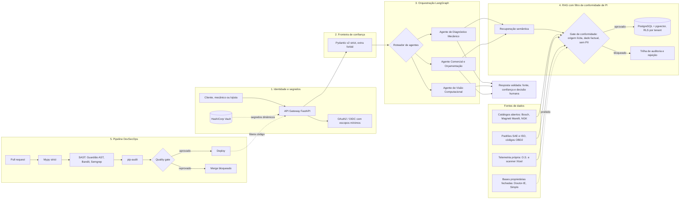

# Ricardo Luiz G. Flávio — Direito Digital × Segurança da Informação × Engenharia de IA

[](https://www.linkedin.com/in/ricardo-flavio/)


> **Bacharelado em Direito** — FACIC, Cruzeiro (7º semestre) · **Graduação em Segurança da Informação** — UCB, Universidade
> Católica de Brasília (3º semestre) · **Em busca de estágio** em AppSec, DevSecOps, GRC, Direito Digital e Engenharia de IA.

## 🇬🇧 Executive summary

I am a dual-degree student (Law, 7th semester; Information Security, 3rd semester) who builds what most teams only
document: **legal requirements turned into executable security and compliance controls**. My flagship project,
**AutoTech AI OS & Zezé da Regulagem**, is a monorepo SaaS (B2B/B2C) for the automotive aftermarket. It combines a
**LangGraph multi-agent system** (mechanical diagnosis, computer vision, commercial quoting), a **semantic RAG on
PostgreSQL + `pgvector`**, **OAuth2 with Vault-managed secrets**, strict **Pydantic/Mypy** validation and a **SAST
pipeline** (proprietary AST auditor "Guardião", Bandit, Semgrep).

What sets it apart is the **IP-compliance-by-design RAG**: the architecture *forbids* scraping closed proprietary
databases and ingests only public factual technical data (Ohms, Volts, bar, pinouts, SAE/ISO OBD2 codes, torque in Nm),
open manufacturer catalogs and first-party telemetry — aligned with Brazil's Copyright Law (9.610/98), Software Law
(9.609/98) and LGPD (data protection). This repository is the **public showcase**: runnable code, a CI pipeline and a
technical-legal ADR.

**Looking for:** internships in Application Security, DevSecOps, GRC / Privacy, Digital Law (LGPD, AI governance, IP) or
AI Engineering (Python / LangGraph / RAG).

---

## 🎯 A convergência que diferencia este perfil

Segurança e Direito falam sobre o mesmo problema — **risco** — em linguagens diferentes. Eu traduzo entre as duas.

| Pergunta do jurídico | Pergunta da engenharia | Controle que eu entrego |
|---|---|---|
| "Podemos usar esse conteúdo para alimentar a IA?" | "Qual é a origem e a licença deste dado?" | `SourceType` + `SourceProvenance`: **Compliance as Code** que bloqueia fontes não auditadas na ingestão |
| "Há dado pessoal na telemetria?" (LGPD) | "O que entra no índice vetorial?" | *Privacy by Design*: base legal obrigatória, varredura de PII e segregação por `tenant_id` |
| "Como provamos diligência numa auditoria?" | "Onde está a evidência?" | `audit_id`, hash SHA-256 por fragmento e relatórios de CI como artefato |
| "A IA pode causar dano?" | "O que acontece se o LLM for manipulado?" | OWASP Top 10 for LLM: saída validada, ferramentas em *allow-list*, nenhum `eval` de saída de modelo |

Isso importa em times de AppSec, GRC, Privacidade e IA porque a pergunta relevante não é só "o modelo funciona?", e sim
**"conseguimos defender, técnica e juridicamente, como ele foi construído?"**

---

## 🏗️ Case principal: AutoTech AI OS & Zezé da Regulagem

Ecossistema **SaaS B2B/B2C** em **monorepo** para oficinas, mecânicos e motoristas.

**Módulos de negócio**

- **Planos de assinatura de manutenção preventiva** — recorrência, cobrança e histórico por veículo.
- **SOS Guincho / Emergência** — acionamento de socorro com geolocalização e despacho.
- **Barganha do Zezé** — *marketplace* P2P de peças e serviços com negociação.

**Agentes (LangGraph)**

| Agente | Responsabilidade | Fontes de conhecimento |
|---|---|---|
| Diagnóstico Mecânico / Engenharia | Hipóteses de falha a partir de sintomas e códigos DTC | RAG `pgvector` filtrado por conformidade |
| Visão Computacional | Leitura de peças, painéis e danos a partir de imagens | Imagens enviadas pelo usuário, com consentimento |
| Comercial / Orçamentação | Composição de orçamento e plano de manutenção | Catálogos abertos e histórico próprio de O.S. |

### Arquitetura de referência (fluxo seguro)



**Leitura do diagrama.** (1) toda requisição passa por OAuth2 e segredos nunca vivem no código; (2) nada entra nos agentes
sem validação estrita; (3) os agentes têm responsabilidades isoladas; (4) o RAG só admite dados que passaram pelo gate de
conformidade, e as fontes proibidas são bloqueadas por arquitetura; (5) o código que implementa tudo isso só chega à
produção após o *quality gate* de SAST.

### Engenharia de segurança (DevSecOps)

| Camada | Prática | Evidência neste repositório |
|---|---|---|
| Identidade | OAuth2 com escopos mínimos | ADR, risco R7 |
| Segredos | Gestão via **Vault**; zero credenciais no código | Regra GRD-002 do Guardião |
| Validação | **Pydantic v2** (`extra="forbid"`, limites e `Enum`) e **Mypy strict** | [`rag_legal_ingestion_schema.py`](showcase/rag_legal_ingestion_schema.py) |
| SAST proprietário | **Guardião**: análise de AST (`ast.NodeVisitor`), 8 regras com CWE/OWASP | [`devsecops_guardiao_ast.py`](showcase/devsecops_guardiao_ast.py) |
| SAST de mercado | **Bandit** e **Semgrep** (regras OWASP + regras próprias de governança de IA) | [`.semgrep/ai-governance.yml`](.semgrep/ai-governance.yml) |
| SCA | `pip-audit` sobre dependências fixadas | [`secops-audit.yml`](.github/workflows/secops-audit.yml) |
| Governança | ADR com matriz de risco e rastreabilidade normativa | [`COMPLIANCE_AND_AI_GOVERNANCE.md`](docs/COMPLIANCE_AND_AI_GOVERNANCE.md) |

### Governança jurídica e *IP compliance* (Legal Design técnico)

O RAG foi desenhado sob a **Lei 9.610/98** (Direitos Autorais), a **Lei 9.609/98** (Software) e a **LGPD**:

- ❌ **Proibido por arquitetura:** *scraping*, *crawling* ou extração de bases proprietárias fechadas (como Doutor-IE e
  Simplo).
- ✅ **Permitido:** dados técnicos **factuais** de domínio público (Ohms, Volts, bar, pinagem, códigos SAE/ISO OBD2, torques
  em Nm), **catálogos abertos** de fabricantes (Bosch, Magneti Marelli, NGK etc.) e **telemetria empírica própria**
  (Ordens de Serviço e scanner Xtool/OBD2).
- 🔐 **Privacy by Design:** telemetria exige base legal, anonimização e segregação por inquilino.

A lógica não é uma política em PDF: é o contrato de dados executável em
[`rag_legal_ingestion_schema.py`](showcase/rag_legal_ingestion_schema.py), testado em CI.

---

## 🧪 Showcase executável

| Arquivo | O que demonstra |
|---|---|
| [`showcase/devsecops_guardiao_ast.py`](showcase/devsecops_guardiao_ast.py) | Auditor SAST por AST: `eval`/`exec`, segredos *hardcoded*, SQL concatenado, *endpoints* sem validação, `shell=True`, desserialização insegura, TLS desabilitado e hashes fracos. Relatório no terminal, saída JSON e *quality gate* por severidade. |
| [`showcase/rag_legal_ingestion_schema.py`](showcase/rag_legal_ingestion_schema.py) | *Compliance as Code* com Pydantic v2: valida origem (`SourceType`), método de coleta, licença, PII e marcadores de copyright antes de qualquer escrita no `pgvector`. |
| [`showcase/langgraph_rag_agent.py`](showcase/langgraph_rag_agent.py) | Orquestrador multi-agente determinístico (`StateGraph`) sobre o gate jurídico: guardrail de **prompt injection (OWASP LLM01)**, RAG que só recupera fontes aprovadas, roteamento entre agentes de Diagnóstico, Visão e Comercial e guardrail de saída com citação rastreável (**OWASP LLM05**). Estado imutável e trilha de auditoria. |
| [`.github/workflows/secops-audit.yml`](.github/workflows/secops-audit.yml) | Pipeline: Mypy strict → Bandit → Semgrep → Guardião (autoteste + gate) → gate RAG → orquestrador multi-agente (autoteste + demo) → pip-audit. |
| [`.semgrep/ai-governance.yml`](.semgrep/ai-governance.yml) | Regras próprias de Semgrep, inclusive a que bloqueia referências a bases proprietárias fechadas. |
| [`docs/COMPLIANCE_AND_AI_GOVERNANCE.md`](docs/COMPLIANCE_AND_AI_GOVERNANCE.md) | RFC/ADR técnico-jurídico, matriz de risco e rastreabilidade normativa. |
| [`docs/LINKEDIN_KIT.md`](docs/LINKEDIN_KIT.md) | Kit de posicionamento: headlines, "Sobre", projeto (STAR), competências e posts. |

> **Escopo deste repositório.** Este é o *showcase público*: contém os componentes de segurança e conformidade que posso
> demonstrar sem expor o produto (auditor SAST, contrato de dados do RAG, orquestrador multi-agente com guardrails, pipeline
> de CI e ADR). O orquestrador usa um `StateGraph` próprio e determinístico, com a mesma API conceitual do LangGraph e sem
> LLM real, para provar a arquitetura de controle. O monorepo completo do AutoTech AI OS (agentes com LLM, OAuth2/Vault,
> módulos de negócio), hoje em teste em uma oficina real em Lorena-SP, é privado.
> *Public showcase: the full product monorepo is private.*

### Executar localmente

```bash
python3 -m venv .venv && source .venv/bin/activate
python -m pip install -r requirements.txt -r requirements-dev.txt

python showcase/devsecops_guardiao_ast.py --demo        # relatório SAST de um módulo vulnerável
python showcase/devsecops_guardiao_ast.py --self-test   # regressão do detector
python showcase/devsecops_guardiao_ast.py showcase --fail-on high
python showcase/rag_legal_ingestion_schema.py           # gate de ingestão: 3 aceitos, 3 rejeitados
python showcase/langgraph_rag_agent.py                  # 3 cenários: legítimo, prompt injection, fonte não auditada
python showcase/langgraph_rag_agent.py --self-test      # 30 verificações dos guardrails
mypy --strict showcase && bandit -r showcase -ll
```

Trecho da saída do gate de ingestão:

```text
[ACEITO   ] Catálogo aberto Bosch — resistência de bobina
[REJEITADO] BLOQUEIO — scraping de base proprietária (Doutor-IE)
    motivo      : provenance: fonte proprietária fechada bloqueada (Lei 9.609/98 e Lei 9.610/98) ...
[REJEITADO] BLOQUEIO — telemetria com dado pessoal (placa e CPF)
    motivo      : <modelo>: dado pessoal detectado (CPF, placa): anonimize antes da ingestão (LGPD)
```

### Estrutura do repositório

```text
.
├── README.md
├── LICENSE
├── docs/
│   ├── COMPLIANCE_AND_AI_GOVERNANCE.md
│   └── LINKEDIN_KIT.md
├── showcase/
│   ├── devsecops_guardiao_ast.py
│   ├── langgraph_rag_agent.py
│   └── rag_legal_ingestion_schema.py
├── .semgrep/ai-governance.yml
├── .github/workflows/secops-audit.yml
├── pyproject.toml
├── requirements.txt
└── requirements-dev.txt
```

---

## 🧰 Competências

**Segurança:** AppSec · DevSecOps · SAST/AST · SCA · Threat Modeling · OWASP Top 10 · OWASP Top 10 for LLM · OAuth2 ·
Gestão de segredos (Vault) · Secure SDLC · GRC · ISO/IEC 27001.
**IA e dados:** Python · LangGraph · Multi-Agent Systems · RAG · PostgreSQL · pgvector · Pydantic · Mypy · FastAPI.
**Jurídico:** LGPD · Governança de IA · Propriedade Intelectual · Direitos Autorais (Lei 9.610/98) · Lei do Software
(Lei 9.609/98) · Privacy by Design · Compliance as Code · Legal Design.

## 🤝 Contato

**Ricardo Luiz G. Flávio** — Direito (FACIC Cruzeiro, 7º semestre) e Segurança da Informação (UCB, 3º semestre).

👉 [LinkedIn — Ricardo Luiz G. Flávio](https://www.linkedin.com/in/ricardo-flavio/)

Aberto a conversas sobre estágio e projetos em segurança, privacidade e IA responsável. O perfil no LinkedIn e este
repositório contam a mesma história: **segurança e conformidade projetadas desde o primeiro commit.**

> Aviso: o conteúdo jurídico deste repositório é educacional e de portfólio; não constitui aconselhamento jurídico.

Licença: [MIT](LICENSE).
