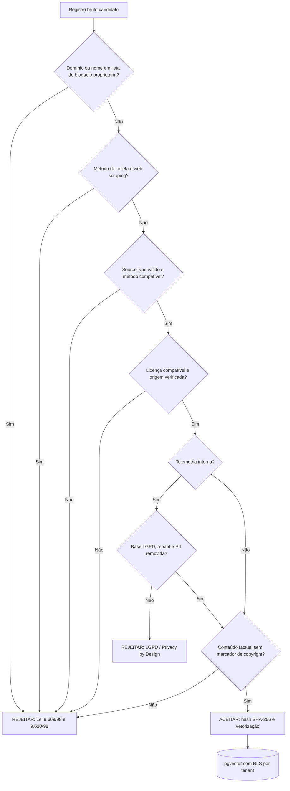

# RFC-001 / ADR-001 — Governança de Dados para IA: RAG Lícito, Privacy by Design e Security by Design

| Campo | Valor |
|---|---|
| **Status** | Aceito (v1.0) |
| **Projeto** | AutoTech AI OS & Zezé da Regulagem |
| **Autor** | Ricardo Luiz G. Flávio ([LinkedIn](https://www.linkedin.com/in/ricardo-flavio/)) — Direito (FASC, 8º sem.) e Segurança da Informação (UCB, 6º sem.) |
| **Domínios** | Direito Digital · GRC · AppSec · Engenharia de IA |
| **Marco normativo** | Lei 9.610/98 (Direitos Autorais) · Lei 9.609/98 (Software) · Lei 13.709/2018 (LGPD) |
| **Referenciais técnicos** | OWASP Top 10 for LLM Applications (2025) · OWASP Top 10 (2021) · NIST AI RMF 1.0 · ISO/IEC 27001 · ISO/IEC 42001 |
| **Implementação de referência** | [`showcase/rag_legal_ingestion_schema.py`](../showcase/rag_legal_ingestion_schema.py) · [`showcase/devsecops_guardiao_ast.py`](../showcase/devsecops_guardiao_ast.py) · [`.semgrep/ai-governance.yml`](../.semgrep/ai-governance.yml) |

> **Aviso.** Este documento é um artefato de portfólio e de engenharia. Não constitui parecer jurídico nem
> aconselhamento profissional; ilustra *como* requisitos legais são traduzidos em controles técnicos verificáveis.

---

## 1. Contexto

O AutoTech AI OS usa agentes LangGraph (diagnóstico mecânico, visão computacional e orçamentação comercial) apoiados por
um RAG semântico em PostgreSQL com `pgvector`. A qualidade do diagnóstico depende de dados técnicos automotivos, e o
mercado oferece atalhos juridicamente perigosos: bases proprietárias fechadas (por exemplo **Doutor-IE** e **Simplo**),
manuais de editoras e acervos cuja reprodução não foi licenciada.

Em sistemas de IA o risco jurídico **nasce na ingestão**: depois que um conteúdo ilícito é vetorizado e misturado ao
índice, ele contamina respostas, evidências de auditoria e o próprio ativo de dados da empresa. Remover um fragmento de um
índice vetorial já em produção é caro e, muitas vezes, incerto. A decisão arquitetural é, portanto, **impedir a entrada**
(*fail-closed*), em vez de remediar depois.

## 2. Problema

1. Como alimentar um RAG de domínio técnico **sem** reproduzir obra intelectual protegida (Lei 9.610/98) nem violar
   contratos/termos de uso e a proteção de programas de computador e bases (Lei 9.609/98)?
2. Como usar a **telemetria própria** (Ordens de Serviço e scanner Xtool/OBD2) respeitando a LGPD, apesar de ela conter
   dados pessoais indiretos (placa, nome, telefone)?
3. Como proteger a cadeia de agentes contra as classes de ataque do **OWASP Top 10 for LLM Applications**?
4. Como tornar tudo isso **auditável** por GRC, e não apenas uma intenção em política interna?

## 3. Decisão

Adotar **Compliance as Code**: cada requisito jurídico vira uma regra executável, versionada, testada em CI e rastreável
a um fundamento normativo.

| # | Decisão arquitetural | Fundamento | Implementação |
|---|---|---|---|
| D1 | Ingestão **somente** de três origens (`SourceType`): catálogo aberto de fabricante, padrão SAE/ISO e telemetria interna | Lei 9.610/98, arts. 7º, 8º e 29 | `SourceType`, `ALLOWED_METHODS`, `ALLOWED_LICENSES` |
| D2 | Armazenar **fatos técnicos** (Ω, V, bar, Nm, pinagem, DTC) e rejeitar prosa de terceiros | Lei 9.610/98, art. 8º (ideias, procedimentos e informações de uso comum não são objeto de proteção) | `ContentClass`, `FACTUAL_SIGNALS` |
| D3 | **Proibição arquitetural de scraping** e de domínios proprietários fechados | Lei 9.609/98; Lei 9.610/98, arts. 7º, XIII e 87 (bases de dados); termos de uso | `BLOCKED_PROPRIETARY_MARKERS`, `CollectionMethod.WEB_SCRAPING` rejeitado |
| D4 | Rejeitar marcadores de obra protegida (©, "todos os direitos reservados") e limitar o tamanho do fragmento | Lei 9.610/98, arts. 29 e 46 (reprodução parcial/integral) | `PROTECTED_WORK_MARKERS`, `MAX_CHUNK_CHARS` |
| D5 | Telemetria exige **base legal**, `tenant_id`, anonimização e *scan* de PII no conteúdo | LGPD, arts. 6º (finalidade, necessidade), 7º, 12 e 46 | `LgpdLegalBasis`, `PII_PATTERNS`, `pii_scrubbed` |
| D6 | **Trilha de auditoria** por fragmento (`audit_id`, `audited_by`, `collected_at`, hash SHA-256) | LGPD, art. 6º, X (responsabilização e prestação de contas); ISO/IEC 27001 A.5/A.8 | `SourceProvenance`, `fingerprint` |
| D7 | Pipeline **SAST + SCA + regras de governança** como *quality gate* | Security by Design; OWASP SAMM; NIST SSDF | [`secops-audit.yml`](../.github/workflows/secops-audit.yml) |
| D8 | Agentes sem *excessive agency*: ferramentas com *allow-list*, saída validada por Pydantic, nenhuma execução de saída de LLM | OWASP LLM05 e LLM06 | Guardião GRD-001/004/005, Semgrep |

## 4. Distinção central: dado técnico factual × obra intelectual protegida

A Lei 9.610/98 protege **criações do espírito** expressas em suporte (art. 7º) e **exclui** da proteção, entre outros,
ideias, métodos, procedimentos normativos e informações de uso comum (art. 8º). Na prática da engenharia:

| Critério | Dado técnico factual (ingestão **permitida**) | Obra protegida / base proprietária (ingestão **proibida**) |
|---|---|---|
| Natureza | Fato objetivo e funcional: "bobina, resistência primária 0,5 Ω"; "P0301 = falha de combustão no cilindro 1"; "torque 38 Nm" | Texto explicativo, diagramas autorais, passo a passo editorial, estrutura e curadoria originais |
| Criatividade | Sem escolha expressiva: o valor é determinado pela física ou pelo padrão | Seleção, organização e redação originais (art. 7º, XIII) |
| Origem | Catálogo aberto de fabricante (Bosch, Magneti Marelli, NGK…), padrão SAE/ISO, medição própria | Doutor-IE, Simplo, manuais de editoras, PDFs de acesso restrito |
| Coleta | Download oficial, digitação auditada, scanner OBD2, exportação de O.S. | *Scraping*, *crawling*, burla de autenticação ou de paywall |
| Risco principal | Erro técnico (acurácia); baixo risco autoral | Violação de direitos autorais e de software, concorrência desleal, ruptura contratual |
| Controle | `FACTUAL_SIGNALS` exige a unidade/padrão na classe declarada | Bloqueio por domínio, método e marcadores de copyright |
| Evidência | `audit_id` + `fingerprint` + `license_basis` | Rejeição registrada com motivo no gate |

**Cautela técnico-jurídica.** Fatos isolados não são protegidos, mas a *compilação* (seleção e organização) pode ser (arts.
7º, XIII, e 87). Por isso o sistema (i) guarda **fragmentos factuais curtos**, (ii) não replica a estrutura de nenhuma base
de terceiros, (iii) preserva a origem para atribuição e auditoria e (iv) mantém o conhecimento **próprio** como principal
ativo, construído com telemetria empírica. Catálogos "abertos" ainda têm termos de uso: o domínio entra na *allow-list*
(`AUDITED_CATALOG_DOMAINS`) somente após revisão jurídica registrada em `audit_id`.

## 5. Matriz de risco jurídico e técnico

Escala: probabilidade (P) e impacto (I) de 1 a 5; **risco residual** é a avaliação após os controles.

| ID | Risco | Categoria | P | I | Inerente | Controle(s) | Residual |
|---|---|---|---|---|---|---|---|
| R1 | Ingestão de conteúdo de base proprietária (Doutor-IE/Simplo) | Jurídico — Lei 9.609/98 e 9.610/98 | 4 | 5 | **20 Crítico** | D1, D3; bloqueio no schema; regra Semgrep `autotech.compliance-ip-blocked-proprietary-source`; revisão em PR | 2 × 5 = **10 Médio** |
| R2 | Reprodução de trecho com copyright em resposta do RAG | Jurídico — Lei 9.610/98 | 3 | 4 | **12 Alto** | D2, D4; limite de 1.200 caracteres; resposta com síntese e citação da origem | 2 × 3 = **6 Baixo** |
| R3 | PII (CPF, telefone, placa) em telemetria vetorizada | Privacidade — LGPD | 4 | 4 | **16 Alto** | D5; anonimização na origem; *scan* de PII; `tenant_id`; RIPD | 2 × 4 = **8 Médio** |
| R4 | Vazamento entre inquilinos (multitenancy) via busca vetorial | Segurança — LLM08 | 3 | 5 | **15 Alto** | `tenant_id` obrigatório; *row-level security* no PostgreSQL; filtro de tenant no `WHERE` | 1 × 5 = **5 Baixo** |
| R5 | Prompt injection indireta em documento ingerido | Segurança — LLM01 | 3 | 4 | **12 Alto** | Fontes restritas e auditadas; conteúdo tratado como dado, nunca como instrução; limites de ferramentas | 2 × 3 = **6 Baixo** |
| R6 | Saída de LLM executada como código ou SQL | Segurança — LLM05 | 3 | 5 | **15 Alto** | Guardião GRD-001/003/005; Semgrep; Pydantic; consultas parametrizadas | 1 × 5 = **5 Baixo** |
| R7 | Agente com permissões excessivas (SOS Guincho, orçamentos, pagamentos) | Segurança — LLM06 | 3 | 4 | **12 Alto** | Escopos OAuth2 mínimos; *allow-list* de ferramentas; aprovação humana em ações financeiras | 2 × 3 = **6 Baixo** |
| R8 | Vazamento de segredos (chaves de API, credenciais de banco) | Segurança — A07/A02 | 3 | 5 | **15 Alto** | Vault; Guardião GRD-002; detecção de padrões de tokens; rotação | 1 × 5 = **5 Baixo** |
| R9 | Envenenamento do índice (dado técnico falso) | Segurança/Qualidade — LLM04 | 2 | 5 | **10 Médio** | Proveniência obrigatória; deduplicação por `fingerprint`; revisão por técnico habilitado | 1 × 5 = **5 Baixo** |
| R10 | Vulnerabilidade em dependências (cadeia de suprimentos) | Segurança — LLM03/A06 | 3 | 4 | **12 Alto** | `pip-audit`, versões fixadas, Dependabot | 2 × 3 = **6 Baixo** |
| R11 | Diagnóstico incorreto gerando decisão com dano ao consumidor | Jurídico — CDC, responsabilidade civil; LLM09 | 3 | 5 | **15 Alto** | Resposta como apoio à decisão do mecânico; indicação de confiança e fonte; registro de decisões | 2 × 4 = **8 Médio** |
| R12 | Decisão automatizada sem transparência (preço/orçamento) | Jurídico — LGPD, art. 20 | 2 | 4 | **8 Médio** | Explicabilidade do orçamento; revisão humana; canal do titular | 1 × 4 = **4 Baixo** |

Faixas de classificação: 1–6 Baixo · 7–11 Médio · 12–16 Alto · 17–25 Crítico.

## 6. Privacy by Design (LGPD) — controles por princípio

| Princípio / dispositivo | Controle implementado |
|---|---|
| Finalidade e adequação (art. 6º, I e II) | Telemetria usada apenas para melhoria do diagnóstico; `lgpd_basis` obrigatório |
| Necessidade / minimização (art. 6º, III) | Somente campos técnicos; PII removida antes da vetorização; `extra="forbid"` rejeita campos não previstos |
| Livre acesso e qualidade (art. 6º, IV e V) | `audit_id` e `fingerprint` permitem localizar e excluir registros de um titular |
| Transparência (art. 6º, VI) | Aviso de privacidade; `source_name` e `license_basis` expostos na resposta |
| Segurança (art. 6º, VII; art. 46) | OAuth2, segredos no Vault, TLS, *row-level security*, criptografia em repouso |
| Prevenção (art. 6º, VIII) | SAST/SCA em CI; matriz de risco; RIPD (art. 38) |
| Não discriminação (art. 6º, IX) | Revisão de vieses de precificação no agente comercial |
| Responsabilização (art. 6º, X; art. 37) | Trilha de auditoria; registro das operações de tratamento (ROPA) |
| Anonimização (art. 12) | `pii_scrubbed` + varredura de CPF, e-mail, telefone e placa. A anonimização é verificada por *scan*, mas não é presumida absoluta: se houver risco de reidentificação, o dado continua sendo pessoal |

## 7. Security by Design — OWASP Top 10 for LLM Applications (2025)

| Item | Ameaça no contexto AutoTech | Controle |
|---|---|---|
| **LLM01** Prompt Injection | Texto de catálogo ou mensagem do cliente instruindo o agente | Conteúdo recuperado é dado, não instrução; ferramentas com *allow-list*; validação de esquema na saída |
| **LLM02** Sensitive Information Disclosure | Telemetria expondo dados de clientes | Anonimização, `tenant_id`, RLS, filtros de saída |
| **LLM03** Supply Chain | Pacotes e modelos de terceiros | Versões fixadas, `pip-audit`, revisão de dependências |
| **LLM04** Data and Model Poisoning | Fragmento técnico adulterado | Proveniência, auditoria, deduplicação, revisão humana |
| **LLM05** Improper Output Handling | Saída do LLM em SQL, shell ou `eval` | Guardião GRD-001/003/005; Semgrep; Pydantic |
| **LLM06** Excessive Agency | Agente aprovando orçamento ou acionando guincho | Escopos OAuth2 mínimos; confirmação humana em ações irreversíveis |
| **LLM07** System Prompt Leakage | Exposição de políticas internas | Nenhum segredo em prompts; segredos somente no Vault |
| **LLM08** Vector and Embedding Weaknesses | Vazamento entre tenants; inversão de *embeddings* | Filtro de tenant obrigatório, RLS, controle de acesso ao índice |
| **LLM09** Misinformation | Diagnóstico mecânico incorreto | Citação da fonte e do nível de confiança; decisão final do profissional |
| **LLM10** Unbounded Consumption | Custos e DoS por consultas abusivas | *Rate limiting* por tenant, limites de tokens e de *top-k* |

## 8. Fluxo de decisão do gate de ingestão



## 9. Consequências

**Positivas.** Rastreabilidade ponta a ponta; defesa documentada em caso de questionamento (evidência de diligência e
boa-fé); redução do risco jurídico sem bloquear a evolução do produto; falhas de conformidade detectadas em *pull request*.

**Custos e limitações.**

- Cobertura de conhecimento menor no curto prazo, compensada pelo acúmulo de telemetria própria.
- Heurísticas (regex de PII e de copyright) geram falsos positivos e negativos; por isso existem camadas
  complementares (anonimização na origem, revisão humana e auditoria amostral).
- A *allow-list* de catálogos exige revisão jurídica periódica dos termos de uso.
- A análise estática do Guardião é intraprocedural e não substitui *pentest*, DAST nem revisão manual.

**Evolução.** Integrar o `TechnicalChunk` ao *pipeline* de ingestão real, adicionar testes de propriedade (Hypothesis),
publicar RIPD e ROPA, e acompanhar o marco regulatório de IA em tramitação no Brasil (PL 2338/2023).

## 10. Como verificar

```bash
python -m pip install -r requirements.txt -r requirements-dev.txt
python showcase/rag_legal_ingestion_schema.py          # 3 aceitos e 3 rejeitados, com motivo
python showcase/devsecops_guardiao_ast.py --demo       # relatório SAST de módulo vulnerável
python showcase/devsecops_guardiao_ast.py --self-test  # regressão do detector (8 regras)
mypy --strict showcase && bandit -r showcase -ll
semgrep scan --config .semgrep/ai-governance.yml --metrics=off --error showcase
```

## 11. Rastreabilidade normativa

| Norma | Dispositivo | Onde está no código |
|---|---|---|
| Lei 9.610/98 | arts. 7º, 8º, 29, 46, 87 | `ContentClass`, `FACTUAL_SIGNALS`, `PROTECTED_WORK_MARKERS`, `MAX_CHUNK_CHARS` |
| Lei 9.609/98 | proteção do programa de computador e vedação à violação | `BLOCKED_PROPRIETARY_MARKERS`, `CollectionMethod.WEB_SCRAPING` |
| Lei 13.709/2018 (LGPD) | arts. 6º, 7º, 12, 20, 37, 38 e 46 | `LgpdLegalBasis`, `PII_PATTERNS`, `pii_scrubbed`, `audit_id` |
| OWASP LLM Top 10 (2025) | LLM01–LLM10 | Guardião, Semgrep, Pydantic, RLS |
| OWASP Top 10 (2021) | A02, A03, A04, A06, A07, A08 | Guardião GRD-001 a GRD-008 |
